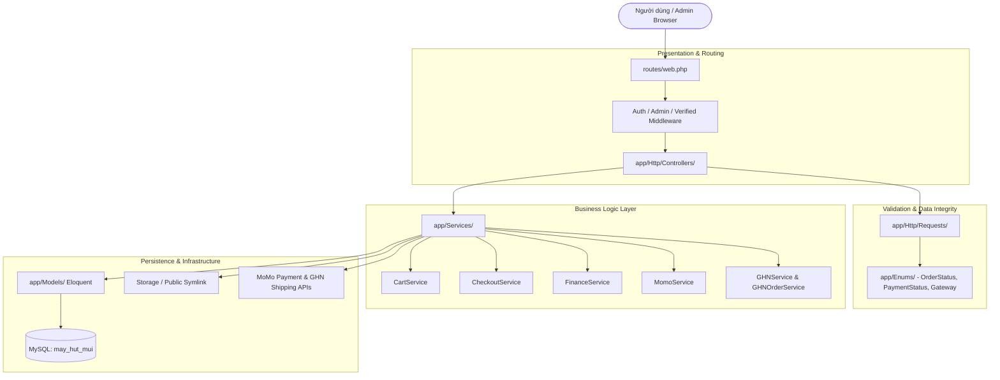

# 🏛️ TÀI LIỆU KIẾN TRÚC HỆ THỐNG (SYSTEM ARCHITECTURE)
**Dự án**: Website Thương Mại Điện Tử Máy Hút Mùi Store  
**Framework**: Laravel 12.x | PHP 8.2+ | MySQL 8.x | Vite + TailwindCSS 4  

---

## 1. TỔNG QUAN KIẾN TRÚC PHÂN TẦNG (TIERED ARCHITECTURE)

Hệ thống được thiết kế theo nguyên lý **Separation of Concerns (SoC)** và **Clean Controller**, chia thành 5 phân tầng mạch lạc:

---

## 2. CHI TIẾT CÁC PHÂN TẦNG

### 2.1. Presentation Layer (`app/Http/Controllers/`)
- **Customer Controllers** (`Customer/`):
  - `HomeController`: Banner, sản phẩm nổi bật, danh mục hot.
  - `ProductController`: Danh sách sản phẩm, lọc theo kích thước/màu sắc/công suất, chi tiết sản phẩm.
  - `CartController`: Điều phối thêm/sửa/xóa giỏ hàng, ủy quyền cho `CartService`.
  - `CheckoutController`: Nhận `CheckoutRequest`, gọi `CheckoutService->placeOrder()`.
  - `MomoController`: Xử lý luồng redirect MoMo, callback và IPN.
  - `OrderController` & `ReviewController`: Lịch sử đơn hàng và đánh giá sản phẩm.
- **Admin Controllers** (`Admin/`):
  - `DashboardController`: Thống kê tổng quan đơn hàng, doanh số.
  - `ProductController`: CRUD sản phẩm, thông số kỹ thuật, upload đa ảnh.
  - `OrderController`: Quản lý trạng thái, tạo/hủy vận đơn GHN.
  - `FinanceController`: Thống kê tài chính, ủy quyền cho `FinanceService`.

### 2.2. Business Logic Layer (`app/Services/`)
- **`CartService`**:
  - Quản lý session và database cart cho người dùng đã đăng nhập.
  - Kiểm tra tồn kho thời gian thực của từng biến thể (`ProductVariant.stock`).
  - Phát hiện và cảnh báo các sản phẩm có vấn đề (hết hàng, ngừng kinh doanh).
- **`CheckoutService`**:
  - Bao bọc toàn bộ chu trình đặt hàng trong `DB::transaction`.
  - Cơ chế Pessimistic Locking (`lockForUpdate()`) để chống Race Condition khi nhiều người cùng mua sản phẩm cuối cùng trong kho.
  - Tự động gọi GHN tính cước giao hàng chính xác theo Tỉnh/Huyện/Xã.
  - Tạo `PaymentTransaction` và trừ tồn kho tự động.
- **`FinanceService`**:
  - Tổng hợp chỉ số doanh thu (COD vs MoMo), lọc đa tiêu chí (ngày, giá trị, trạng thái).
  - Quản lý chuyển đổi trạng thái giao dịch an toàn (State Machine).
- **`MomoService`**:
  - Tạo request thanh toán QR/ATM, ký số SHA256 HMAC theo chuẩn MoMo API v2.
  - Xác thực chữ ký phản hồi IPN/Callback chống giả mạo dữ liệu.
- **`GHNService` & `GHNOrderService`**:
  - Tra cứu Tỉnh/Huyện/Xã chuẩn quốc gia từ GHN API.
  - Tạo đơn giao hàng thu hộ COD, in vận đơn, hủy vận đơn.

### 2.3. Data Model Layer (`app/Models/` & `database/migrations/`)
- **Mối quan hệ cốt lõi**:
  - `Product` 1-N `ProductVariant` (Mỗi sản phẩm có nhiều cấu hình Size x Color).
  - `ProductVariant` N-1 `Size`, N-1 `Color`.
  - `Product` 1-1 `ProductDetail` (Thông số kỹ thuật: công suất hút $m^3/h$, độ ồn dB, số tốc độ, điện áp...).
  - `Order` 1-N `OrderItem`, 1-N `PaymentTransaction`.
  - `Cart` 1-N `CartItem` -> liên kết trực tiếp tới `ProductVariant`.

---

## 3. TÍNH NĂNG BẢO MẬT & TỐI ƯU HIỆU NĂNG

1. **Chống Race Condition trong kho hàng**:
   - Sử dụng `DB::transaction` kết hợp `lockForUpdate()`. Tránh tình trạng âm kho khi flash sale.
2. **Bảo toàn hình ảnh & Asset Pipeline**:
   - Sử dụng `public/storage` symlink kết hợp bộ kiểm tra đường dẫn thông minh trong `Product::imagePath()`.
   - Biên dịch TailwindCSS 4 + Vite tối ưu dung lượng file production < 40KB gzipped.
3. **Bảo mật cổng thanh toán**:
   - Mọi thông báo IPN từ MoMo đều phải trải qua bước kiểm tra chữ ký bí mật `hash_hmac('sha256')`.
   - Cơ chế Idempotent: Giao dịch đã thanh toán không bị cập nhật lại nhiều lần.
